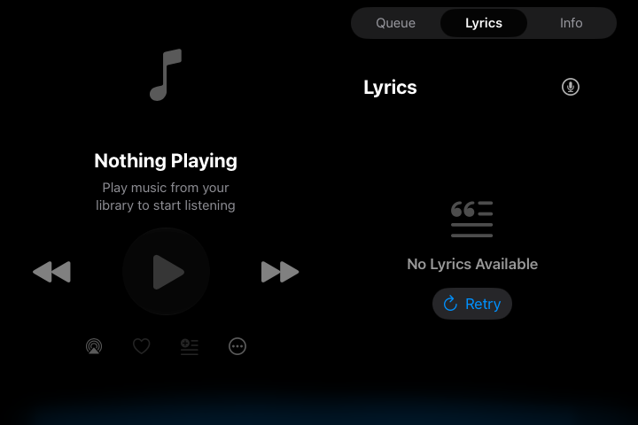
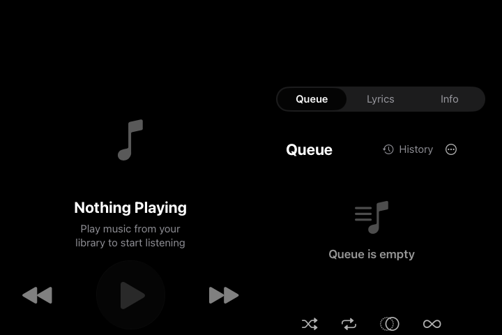

# AirPlay Screen Mirroring: missing TV Now Playing

Date: 2026-10-17. The initial investigation was read-only apart from this
report. Felicity subsequently approved the SwiftUI accessory fix, an iOS build,
simulator external-display checks, and a local commit. The investigation below
describes the pre-fix source; the implementation and evidence are recorded at
the end. No unit or integration test suites were requested or run.

Examined `investigate/tv-now-playing-mirroring` at
`2544a52ad77dc3ed98db4933335b588fb6605ae8`. Local `develop` resolved to the
same commit during inspection. All history reads used that local history;
`develop` was not checked out or modified. The worktree started clean.

## Initial finding and confidence

**The strongest explanation is a missing iOS 27 external-display accessory
registration.** Ensemble still waits for UIKit to offer a noninteractive
external-display scene automatically. Apple explicitly stopped doing that for
apps built with the iOS 27 SDK. Neither registration existed in the inspected
baseline. The simulator comparison below subsequently confirmed this activation
gap and the correction.

This is a confirmed source compatibility gap. In a follow-up, Felicity reports
using “the latest builds of the whole stack” and seeing “just a regular screen
mirror of my phone screen.” That matches failure to activate the supplementary
scene, rather than a stale dedicated Now Playing view, and strengthens this
diagnosis. Exact OS/build numbers and the installed app's linked SDK have not
been independently recorded, and no agent-run AirPlay reproduction is claimed.
If the failing app is SDK-27-linked on iOS 27, the missing registration directly
explains this symptom. If it is actually on iOS 26, that platform change does
not apply and the existing scene diagnostics must locate the failure.

**The October 16–17 playback re-architecture cannot be the original cause.**
The October 13 plan already calls this feature broken, before steps 1b–1d.
No evidence supports assigning the regression to `3e063453`, `5dfdef45`, or
`c2955b21`.

There is no defensible single app regression commit from the available
evidence. For the leading explanation, the transition is the first affected
SDK-27-linked build running on iOS 27, rather than a source change that deleted
the feature. Xcode/SDK selection is external to this git history.

## Wiring at the investigated baseline

### App and scene configuration

- `Ensemble/App/EnsembleApp.swift:16–19,53–57`: SwiftUI `@main App`, an iOS
  `@UIApplicationDelegateAdaptor(AppDelegate.self)`, and a main `WindowGroup`
  containing `RootView`. This lifecycle was already present in the initial
  commit `0ce16e34`; there is no recent UIKit-to-SwiftUI lifecycle conversion
  responsible for losing the TV view.
- `Ensemble/Info.plist:75–91`: `UIApplicationSceneManifest` sets
  `UIApplicationSupportsMultipleScenes = true`. Its `UISceneConfigurations`
  contains `UIWindowSceneSessionRoleExternalDisplayNonInteractive`, named
  `External Display`, whose delegate is
  `$(PRODUCT_MODULE_NAME).ExternalDisplaySceneDelegate`. There is no old
  `UIWindowSceneSessionRoleExternalDisplay` entry. The external manifest entry
  dates to the original feature and has not been removed.
- `Ensemble.xcodeproj/project.pbxproj:770–776,815–821`: both app configurations
  use the explicit `Ensemble/Info.plist`, `GENERATE_INFOPLIST_FILE = NO`, and
  `INFOPLIST_KEY_UIApplicationSceneManifest_Generation = YES`. These settings
  are not a new regression. Both external delegate and scene-configuration
  extension remain in the app target Sources phase (lines 587,589). This is
  source/project evidence; an actual failing built product's processed plist
  has not been inspected.
- `Ensemble/App/AppDelegate+SceneOrientation.swift:9–28`: the application
  delegate recognizes `.windowExternalDisplayNonInteractive`, constructs
  `UISceneConfiguration(name: "External Display", sessionRole: ...)`, and sets
  `delegateClass = ExternalDisplaySceneDelegate.self`. Other scenes return
  `Default Configuration` at line 38. Interactive iPad extended-desktop windows
  use `.windowApplication`; they are not the TV scene.

### External window and content

`Ensemble/App/ExternalDisplaySceneDelegate.swift` owns the supplementary window:

1. Lines 19–25 accept only the noninteractive role and a `UIWindowScene`.
2. Lines 27–59 obtain `windowScene.screen` and log bounds, scale, `mirrored`,
   available modes, and connected scenes. These are diagnostics, not transport
   gates. There are no `UIScreen.screens` or screen connect/disconnect
   notification listeners implementing this feature.
3. Line 67 sets `playbackService.isScreenMirroringActive = true`.
4. Lines 74–80 use `DependencyContainer.shared.activeNowPlayingViewModel`, or
   create a fallback through `makeNowPlayingViewModel()`.
5. Lines 82–92 inject dependencies, host `ExternalDisplayNowPlayingView` in a
   `UIHostingController`, attach a `UIWindow(windowScene:)`, call
   `makeKeyAndVisible()`, and retain it. No track or audio-route condition gates
   window creation; even idle playback should produce the dedicated UI.
6. Lines 101–106 release the window and clear the mirroring flag unless another
   noninteractive scene remains.

`Packages/EnsembleUI/Sources/Screens/NowPlaying/ExternalDisplayNowPlayingView.swift:13–39`
observes the supplied model and settings. It renders `NowPlayingBackdrop`
(`consumer: .externalDisplay`) and `NowPlayingWidePanelLayout`, using dark
presentation and the configured accent color. The panel layout has controls
on the left and Queue/Lyrics/Info on the right. External content uses unlimited
available width and centering. It does not conditionally disappear when idle.

`NowPlayingWidePanelLayout.swift:53–76,118–133` lays out two panels from the
available geometry. This is shared iPad layout code, not the normal phone
navigation shell. The current TV view is therefore dedicated supplementary
content, even though it reuses the wide components.

### Shared model and playback routes

`RootView.swift:49–54` creates its model and line 113 publishes the active model
to the container on appearance. `DependencyContainer+ViewModelFactories.swift:20–23,45–64`
provides the shared-model pointer and creates models using the shared playback
service. The TV normally shares playback and panel selection directly. If it
connects before the main UI publishes its model, its fallback observes playback
but does not later switch to the main model, so panel selection can diverge.
That pre-existing ordering caveat can explain a panel-sync issue, not why no
external window appears.

`NowPlayingViewModel.swift:263–275` subscribes to current-track and playback
state publishers; lines 452–480 update time/duration projections, and lines
657–664 consume presentation time for lyrics. The underlying service still
publishes track/state/time (`PlaybackService.swift:822–889`) and updates time
in `updatePlaybackTimes` (lines 2304–2310). No dropped observation connection
was identified by source inspection.

`PlaybackService.swift:299–314,1078–1086,2340–2373` uses
`AVAudioSession.currentRoute.outputs` to infer AirPlay/Bluetooth presentation
latency. `isScreenMirroringActive` suppresses separate AirPlay latency
compensation, because mirroring already synchronizes audio/video. The flag is
set *after* receiving the external scene; it does not discover or activate it.
`isExternalPlaybackActive` is a presentation-route value, not a TV visibility
gate. There is no `AVRouteDetector` or AVPlayer external-video playback check
controlling this window. Audio-only AirPlay selection does not itself request
the dedicated screen.

## History and regression bounds

- **`6e4d786325c12ca8a33a7ae008dcb7df89b7867d` — 2026-03-31
  07:04:04 -07:00 — “Add AirPlay external display now playing (#57)”.**
  Original feature: app-delegate role routing, external manifest entry,
  supplementary window, shared/fallback model, and mirroring latency flag.
  The original view was at
  `Packages/EnsembleUI/Sources/Screens/ExternalDisplayNowPlayingView.swift`.
  Lines 39–63 laid out a 1024×768 reference canvas, constrained it to a 4:3
  area, and scaled it. The original delegate lines 71–88 also guessed wired
  transport from `availableModes.count > 1` and returned without a window.
  This is the code-history anchor for the supplied v0.3.0 changelog quotation;
  the supplied March 24 build identifier is not proof of a particular git SHA.
- **`161ae08e` — 2026-05-07 — “Audit and consolidate the Swift codebase (#80)”.**
  Split app-delegate responsibilities into the present extensions and moved
  UI files; role routing remained. Followed history across those moves.
- **`42731230` — 2026-05-09 — “Share iPad Now Playing layout with AirPlay”.**
  Reused the shared wide layout while initially retaining the reference canvas.
- **`554fbb169c28a02879804c03586ab7f58200cac0` — 2026-05-10
  17:13:30 -07:00 — “Simplify external display now playing layout”.**
  The view diff at old lines 31–99 removed `referenceSize`, `GeometryReader`
  scaling, 4:3 sizing, and `scaleEffect`. It kept the shared wide view with its
  default maximum width. This is a relevant sizing-history change, not evidence
  that scene activation stopped. `0b12e895` recentered the layout that day.
- **`c07cbac88b7b494e160ebbc1d784bc9dedb544be` — 2026-09-29
  15:47:33 -07:00 — “Route supplementary displays by scene role and reuse
  native viewport”.** The delegate diff at old lines 68–96 removed the
  multi-mode/wired heuristic; the view diff at lines 23–34 removed its remaining
  width cap. It added a role guard and handled remaining scenes on disconnect.
  It did not replace the app-delegate routing or remove the manifest. Existing
  `2026-09-29-bug-bash-fixes.md:74–85` records iOS 26.5 simulator TVOut
  connection/reconnection, including the two-mode case, and also records that
  native full-HD sizing and physical AirPlay remained unverified. That is
  historical evidence, not a fresh check in this task.
- **`2b35456ed87273025af09baca07f049bf24ab8e7` — 2026-10-13
  06:35:24 -07:00 — “docs: add re-architecture plan”.** Its original
  `docs/reference/rearchitecture-plan.md:18–20` already says the Screen
  Mirroring Now Playing view stopped working. This supplies a firm
  *reported-broken-by* bound, before later playback work.
- **`f78c7b13ce16c73becf1265c3343860daa86d31d` — 2026-10-13
  07:15:15 -07:00 — “Raise floors to iOS 17 and macOS 15 and remove old-OS
  paths”.** Replaced raw role-string comparisons with the equivalent typed
  `.windowExternalDisplayNonInteractive` at current app-delegate line 20 and
  external-delegate lines 24,104. It did not add accessory registration. The
  broken-feature report predates this commit too.
- **`3e063453` — 2026-10-16 13:36:23 -07:00 — “Route every queue advance
  through one shared rule (step 1b)”; `5dfdef45` — 2026-10-16 18:13:03 -07:00 —
  “One engine event contract with session-stamped adapters (step 1c)”; step 1d
  `16d19d58`, `d4af2959` and seek change `c2955b21` on October 17.** These are
  later than the recorded failure. The cumulative diff from `3e063453^` to the
  inspected HEAD contains no changes to the external delegate, app-delegate
  routing extension, external view, plist, or Xcode project.

Step 1c is relevant if a TV window is present but frozen: it introduced
session-stamped engine events and filters before progress is published
(`PlaybackService.swift:1511–1530,1579–1612`). Native loads are stamped with
the current session; the Apple Music adapter binds before queue start. No
concrete sustained progress-loss path was identified. Step 1d's main-actor
isolation and the pending-seek change do not remove model subscriptions.
They are not explanations for the absence of a scene, and their dates exclude
them as the cause of the already-recorded October 13 failure.

No executed binary bisection is claimed. Searches used `git log --follow`,
`git log -S`/`-G`, commit diffs, and the dated investigation/plan evidence.
Those establish chronology and surviving wiring, not the exact first failing
binary. The original “small / portrait iPad” complaint and complete absence
must be treated as different symptoms.

## Apple platform change that applies

Apple's [iOS & iPadOS 27 release notes](https://developer.apple.com/documentation/ios-ipados-release-notes/ios-ipados-27-release-notes)
identify change **177015874**: SDK-27-built apps no longer receive automatic
`windowExternalDisplayNonInteractive` scenes; they must register an accessory.
The notes also introduce SwiftUI's accessory API (**175548901**).

[Presenting content on a connected display](https://developer.apple.com/documentation/uikit/presenting-content-on-a-connected-display)
explains registration and reusing an existing scene delegate. Merely retaining
a scene configuration in the manifest does not supply this registration.

The separate [scene-lifecycle migration guidance](https://developer.apple.com/documentation/uikit/transitioning-to-the-uikit-scene-based-life-cycle)
describes iOS 26's warning and the iOS 27 requirement. Ensemble already uses
scenes. That general migration requirement is not evidence that it needs a
new app lifecycle.

The installed SDK headers independently confirm that `UISceneAccessory` and
`UIViewController.registerSceneAccessory(_:)` are iOS 27 APIs. `UIScreen.h`
deprecates `screens` and screen connection notifications in iOS 16, and
`mainScreen` in iOS 26. Ensemble obtains the external screen contextually from
`windowScene.screen`; those deprecations do not explain this activation gap.
Deprecated APIs are also not equivalent to removed APIs.

## Proposed correction at investigation handoff

For SDK-27/iOS-27 activation, register the existing TV content explicitly on the
persistent main app interface. Keep iOS 17–26's existing scene setup.

Two supported choices:

1. **Native SwiftUI:** add an availability-gated `.sceneAccessory` containing
   `ExternalNonInteractiveAccessory { ExternalDisplayNowPlayingView(...) }`
   at the root where the main `NowPlayingViewModel` is already owned. Pass the
   same model and dependency environment. This avoids a new UIKit bridge and
   the fallback-model ordering issue on the new path. Preserve mirroring flag
   setup/cleanup on the accessory content's actual presentation lifecycle;
   registering or being available is not the same as being presented. Keep the
   legacy delegate path only for earlier systems and avoid duplicate owners.
2. **Reuse the UIKit delegate:** register
   `UISceneAccessory.externalNonInteractive(sceneConfiguration:)` with
   `delegateClass = ExternalDisplaySceneDelegate.self` on the persistent main
   view controller, retain the registration, and unregister at teardown. This
   reuses the existing window/timing lifecycle, but a SwiftUI app needs a small
   controller integration. It is not enough to instantiate a registration
   object in `AppDelegate` without associating it with a presented controller.

Prefer the native SwiftUI option unless implementation inspection uncovers a
concrete lifecycle blocker. Apple's [SwiftUI accessory documentation](https://developer.apple.com/documentation/swiftui/externalnoninteractiveaccessory)
and [sceneAccessory modifier](https://developer.apple.com/documentation/swiftui/view/sceneaccessory(content:))
document this exact external/AirPlay use. The installed SwiftUI interface
confirms both are available on iOS 27 and unavailable on macOS, watchOS,
tvOS, visionOS, and Catalyst: guard by platform and availability.

This is scene activation work, not a playback re-architecture or TV redesign.
Do not restore fixed canvases, infer transport from display modes, or change
latency arithmetic to address a missing scene. Any sizing changes need their
own observed defect after the dedicated view is presenting.

## Verification and the remaining decision

First record the failing iOS version, Ensemble build and source commit, linked
SDK (`DTSDKName`/`DTXcode` in the processed app plist or `LC_BUILD_VERSION`),
and whether the TV shows the phone mirror, black content, or stale content.
The SDK can change between two builds of the same git commit.

Use the existing logs to classify the failure without adding instrumentation:

- No external routing/`[ExternalDisplay] scene willConnectTo` messages, and no
  external scene in `UIApplication.shared.connectedScenes`: activation stage;
  expected signature of the missing SDK-27 registration.
- Scene callback but no `window visible`: window/delegate setup stage.
- `window visible` but wrong/stale content: inspect model identity, playback
  subscriptions, geometry, and rendered screenshot. An activation migration
  alone is not proof of fixing that symptom.
- An older build logs `Wired display detected ... skipping custom view`: the
  original mode-count heuristic applies; it was removed in `c07cbac8`.

After approval and implementation:

1. **Simulator:** use exact simulator UUIDs and fresh app artifacts, one iOS 27
   device and an iOS 26 control where available. Build through
   `scripts/build_serial.py` using `Ensemble.xcworkspace`; inspect the processed
   plist and prove installed/running artifact identity. Use Simulator **I/O >
   External Displays** (menu wording may vary by Xcode version). Start with no
   playback: the dedicated wide idle view must appear. Connect before launch,
   connect while foregrounded, disconnect/reconnect, and return from background.
   Check play/pause/skip, artwork/progress, and Queue/Lyrics/Info selection.
   Capture actual guest scene/window bounds; a host framebuffer set to 1080p
   does not establish a 1080p UIKit viewport. Shut down only the used UUIDs and
   verify shutdown. A pre-fix SDK-27 binary vs. the fixed binary under the same
   runtime/display conditions supplies the missing red/green evidence.
2. **Real iPhone and TV:** record iOS/app/SDK and receiver details; confirm normal
   mirroring works, then use Control Center **Screen Mirroring** to connect the
   TV and foreground Ensemble. Expect a distinct wide TV view while the phone
   remains usable as the controller, including when idle. Play a track and
   check metadata, artwork, pause/skip, advancing progress, lyrics timing, panel
   selection, navigating away from Now Playing, cold launch while mirrored,
   and reconnect. Compare with audio-only AirPlay, which should not claim the
   TV screen. If available, check iPad interactive external windows remain
   ordinary app windows. Pause playback and lock the phone afterward.

At the original investigation handoff, no agent-run simulator or physical
AirPlay result was available. Implementation was subsequently approved; the
following checks establish simulator behavior. The first affected distributed
build and the exact original phone build remain unknown.

## Approved implementation and simulator evidence

The fix stays on `investigate/tv-now-playing-mirroring`; it does not modify
`PlaybackService` or the other thread's `develop` checkout.

- `ExternalDisplayNowPlayingModifier` registers `ExternalNonInteractiveAccessory`
  with `.sceneAccessory` on iOS 27. `RootView` supplies its existing model, and
  the accessory receives the dependency environment explicitly. The existing
  TV view and panel layout are unchanged.
- The app-delegate external-role override now applies only before iOS 27.
  The legacy delegate and manifest configuration remain available to iOS 17–26.
- The UI modifier tracks presented root-model identities, setting the existing
  mirroring flag until the last presentation ends. It handles content
  disappearance and loss of accessory availability idempotently. This second
  cleanup hook is necessary: an initial runtime iteration removed the external
  scene without delivering content `onDisappear`; the flag otherwise remained
  set. The final build's disconnect and reconnect logs confirm cleanup.

### Build and artifact identity

Baseline and fixed iOS Debug workspace builds passed through
`scripts/build_serial.py` (also used by `prepare_runtime.py`). No test suites
were run. The final lifecycle adjustment passed a focused incremental rebuild.

- SDK: `iphonesimulator27.0`, Xcode metadata `2700`, deployment target iOS 17.
- Baseline: clean app source at `2544a52a`, build `202610171432.2544`, executable
  SHA-256 `de8bd5ebebe1937b08588861e7aa9452c9dd4bd9e9550d6856b47c5283ac5125`.
- Final app: base `2544a52a` plus this commit's Swift changes, build
  `202610171435.2544`, executable SHA-256
  `f67e038638bbfb57e0761062c4f7f83c5c97d1f3cbd3d7026cf9018bd949ae12`.
  Build numbering retained the base commit because verification preceded the
  commit; the recorded dirty status and executable hash distinguish the fix.
- On both simulators, installed executable hashes matched the built executable,
  and running PID executable paths were verified. Final cold-launch PIDs were
  `17766` (iOS 27) and `17812` (iOS 26.5).

### Observed results

1. **iOS 27.0 (24A434), iPhone 18 Pro**, task-owned simulator
   `8241D3D8-216D-4798-AA9D-924433D2A81B`: baseline phone UI worked, but TVOut
   screen 2 showed no dedicated content and no external-delegate callback.
   Simulator TVOut was black, so this establishes the missing supplementary
   content, not a reproduction of the physical TV's ordinary-mirror pixels.
2. With the fix, the same TVOut screen displayed the wide idle Now Playing
   view. Debugger inspection showed a noninteractive external scene with
   SwiftUI's `SceneAccessoryDelegate` and a 720×480 window. The static legacy
   plist entry did not override the SwiftUI accessory.
3. Disconnect removed the external scene and logged mirroring `false`, with
   zero active presentations. Reconnect settled at mirroring `true`, with one
   presentation. Selecting Lyrics on the phone before reconnecting produced
   the Lyrics panel on the TV. The phone retained its independent carousel
   presentation. Cold launch with TVOut already on also showed dedicated
   content. Returning from Settings restored the dedicated TV view.
4. **iOS 26.5 (23F77), iPhone 17 Pro**, task-owned control simulator
   `44BFB330-CF1D-4402-BA91-F3E75B446B3B`: the same final app showed dedicated
   content through `Ensemble.ExternalDisplaySceneDelegate`, confirmed through
   debugger inspection. Disconnect cleared the mirroring flag; reconnect and
   cold launch with TVOut connected recreated the window.

The guest external viewport was 720×480 on both runtimes. These checks do not
establish full-HD layout, TV-distance readability, live track updates, actual
AirPlay transport, or audio/lyrics synchronization. The isolated simulators had
no configured music sources. Multiwindow handoff tracking was source-reviewed
but not exercised on an iPad. A phone Now Playing dismissal attempt was not
accepted by the automation, so dismissal is not claimed as a passed check.

Evidence retained locally:

- `/tmp/ensemble-tv-mirroring-baseline-20261017/`: baseline build, processed
  plist, installed/running identity, and TV screenshot.
- `/tmp/ensemble-tv-mirroring-fixed-20261017/`: initial fixed build and the
  lifecycle rebuild log.
- `/tmp/ensemble-tv-mirroring-final-20261017/ios27/` and `ios26/`: final
  installed/running identities, cold launches, scene delegates/window bounds,
  screenshots, and persistent logs with flag transitions.

Representative external screenshots are committed alongside this report:

At the simulator-only handoff, physical AirPlay acceptance remained in the
[device backlog](../reference/physical-device-backlog.md). The later physical
installation and owner confirmation are recorded below.

Both task-owned simulators were verified `Shutdown`, their Device panel streams
were closed, and the temporary simulator devices were then deleted. Final app
PIDs were independently confirmed absent. Build logs and evidence remain in
the local run directories above; no physical phone or shared simulator was used.

## Physical installation and owner confirmation

On 2026-10-17, clean `c273feb509363a226cd75f03dc486412b7681f5a` was built
for the physical iPhone 16 Pro (`00008140-00023030117B001C`) with the project's
automatic Apple Development signing. The device was paired over Wi-Fi, running
iOS 27.0.1 (24A446), with Developer Mode enabled and no passcode required.
Installation and installed-app readback both confirmed Ensemble 0.4.0 build
`202610171652.2735`. The app used the iOS 27.0 SDK. Local install/build evidence
is under `/tmp/ensemble-tv-iphone-c273feb5-20261017/` and its sibling build log.

On 2026-10-18, Felicity reported: “Tested on my real TV, looks good.” This is
owner-reported physical confirmation that the requested TV presentation is
restored. It was not an agent-observed run, and individual transport, lyrics
timing, reconnect, or iPad checks were not itemized. Those distinctions remain
in the focused device backlog; they do not keep the presentation marked broken.

## Integration with the playback split

The approved integration starts from `origin/develop` at
`dc504b28ac7143cb9f5a0f2b7f536142e39bc06d`, after steps 1e and 1f. A separate
integration checkout preserves the other thread's active `develop` worktree.
Merging `c273feb5` applies cleanly, including the device backlog; no production
conflict resolution or playback edits are necessary.

The mirroring flag remains stored on concrete `PlaybackService`, while its
presentation calculations now live in `PlaybackService+Presentation.swift`.
The accessory still receives that concrete service through the container.
The main and external Now Playing views share the same snapshot-backed model;
the modifier does not depend on the per-field publishers replaced in step 1e.
The iOS 27 registration and iOS 17–26 delegate routing therefore remain intact.

### Integration validation, 2026-10-18

The workspace Debug builds passed for iOS Simulator (`Ensemble`), watchOS
Simulator (`EnsembleWatch`), and native arm64 macOS (`Ensemble`). Each used
`python3 scripts/build_serial.py -workspace Ensemble.xcworkspace` with a
separate DerivedData directory. These are compile checks; no new runtime or
physical acceptance is claimed for the integrated artifact.

All nine package suites were run with `swift test -q --jobs 2 --package-path
Packages/<package>`, serialized with the shared build lock. EnsembleUI,
EnsembleWatchCore, EnsembleDomain, EnsembleAPI, EnsemblePersistence,
EnsembleSiriShared, EnsembleSupport, and EnsemblePlex passed.

EnsembleCore ran 1,157 XCTest cases and eight Swift Testing cases. The Swift
Testing cases passed. Two XCTest cases failed, with eight failure reports:

- `PlaylistDetailViewModelTests.testCreateFeedbackPreservesAccountIdentityAndEachBatchRetry`
- `PlaylistDetailViewModelTests.testPlaylistAddFeedbackPreservesActualCountsAndNavigation`

The full Core suite on a separate, unchanged `dc504b28` checkout reproduces
exactly those two failing cases and eight failure reports. The add-feedback
case passes in isolation there. The same test-order failures are already
recorded in [step 0 verification](2026-10-13-step-0-verification.md) and the
step 1d/1e notes. Persisted offline state seeds a subsequent test's monitor;
its asynchronous online update has not reached `SyncCoordinator.isOffline`
when a playlist operation checks it. The operation therefore takes the offline
path. This merge changes no Core source or tests, and does not repair that
unrelated fixture race.

Within the integrated full Core run, both `testScreenMirroring` cases and
`testLyricsUsePresentationTimeInsteadOfRawPlaybackTime` passed. No new test
failures were observed relative to the unchanged develop baseline. The full
test run is **not green** because of the two existing cases above.

Xcode's generated package schemes were first attempted for tests, but report
that they are not configured for the test action (exit 66); the package
suites above are the executed test evidence.

Logs, command arguments, and exit codes are retained locally under
`/tmp/ensemble-tv-integration-evidence-20261018/`, including
`build-results.json`, `swift-test-results.json`,
`remaining-swift-test-results.json`, and `develop-baseline-core-result.json`.
The existing `{{future}}` Notion changelog entry already describes this fix
and links to `c273feb5`; it was read back without adding a duplicate.
